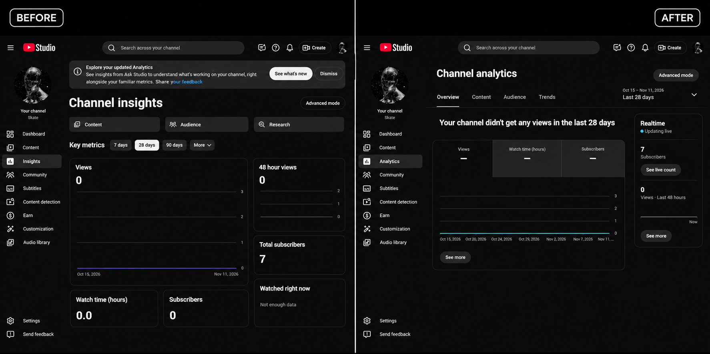

# OldStudio

OldStudio brings back the classic YouTube Studio Analytics overview when Studio opens the newer Insights page.

## Before and after

[Watch the before-and-after screen recording](oldstudio-demo.mp4).

## Install

1. Download this repository as a ZIP and extract it.
2. Open `chrome://extensions` in Chrome and turn on **Developer mode**.
3. Click **Load unpacked** and select the extracted folder containing `manifest.json`.
4. Reload YouTube Studio and open Analytics.

The extension runs only on `studio.youtube.com`. It requests no extension permissions, collects no data, and makes no network requests of its own. It depends on YouTube Studio's internal flag and routes, which YouTube may change.

OldStudio is an independent project and is not affiliated with YouTube or Google.
